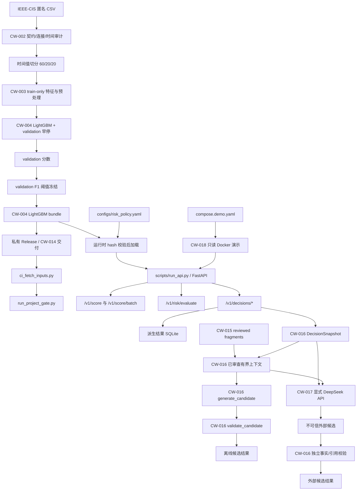
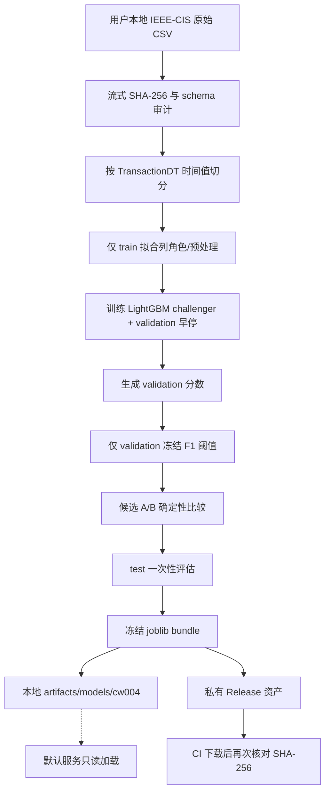
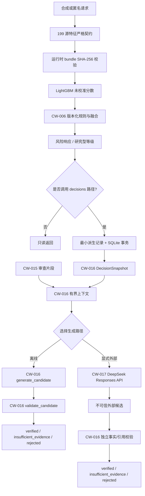
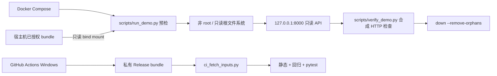

# CW-019 系统架构、数据流与关键取舍

[返回项目总览 README](../README.md)

## 1. 交付边界

本项目是面向作品集的研究原型，不是生产交易风控系统。实际系统由四类边界组成：

1. **离线数据与模型产物**：IEEE-CIS 匿名公开数据只在训练/评估脚本中使用；训练完成后以
   CW-004 LightGBM bundle 作为服务输入，不在服务进程读取原始 CSV、标签或 test 行。
2. **默认服务**：`scripts/run_api.py` 启动 FastAPI，只负责本机回环上的评分、规则求值和可选的
   派生决策存储。默认没有认证、TLS 或公网部署能力；`/v1/score` 是只读评分路径。
3. **离线证据与生成**：CW-015 建立人工审查的规则片段索引，CW-016 生成结构化调查候选并独立校验，
   CW-017 才允许在显式命令和 `DEEPSEEK_API_KEY` 存在时调用 DeepSeek。默认服务路由、默认测试和 CI
   都不调用外部模型。
4. **Docker 演示与 CI**：CW-018 是只读、合成输入的本地 Compose 演示；托管 GitHub Actions
   运行 Windows 质量门禁并从私有 Release 获取已验收 bundle，当前工作流没有 Docker job。

这些边界是研究约束，不是生产合规声明；输入匿名、模型分数未校准，风险等级也不等同于业务处置。

## 2. 可追溯系统图

图中每个节点都对应仓库中的脚本、配置、文档或已验收工作包。实线箭头表示数据或控制流，虚线箭头表示
校验/门禁关系。



## 3. 数据流一：离线数据到可交付模型



这条流的关键事实是“训练边界先于模型”：validation 同时用于 LightGBM 早停和 F1 阈值冻结，test 只评估一次，bundle 不携带原始
CSV。`configs/quality_gate.yaml` 冻结服务配置、政策、12 个合成回归 case 和 bundle 的摘要；服务配置摘要为
`4dd211557214cee85abf1f427f72bfcec3510f6a4d01a928becb141fffb1c865`，政策摘要为
`7ed07f0b784715c01b444035bb34ea5166d1b376ff07e10428561d898d6824f0`，bundle 摘要为
`f02bb50e61c5f70c85448430c8bb653bd6e347f400220771500ee84a70135a1c`；任何摘要
不符时在反序列化或解析前失败关闭。

## 4. 数据流二：请求时评分、政策、调查候选



服务请求不会自动进入调查生成链路。只有派生决策快照和已审查政策片段能进入 CW-016；原始特征、交易行、
默认 SQLite、身份字段和服务载荷不进入 CW-017 请求。DeepSeek 的 `tools` 固定为空数组，凭据只从环境
变量读取，传输/预算/解析异常统一安全降级。

## 5. 数据流三：Docker 演示与托管门禁



Docker 入口在监听端口前检查 bundle/policy；镜像不 COPY 模型，不启用 SQLite、外部 LLM、工具或持久卷。
本地容器实测与托管质量门禁是两类证据，不能用 Actions 的绿色状态代替 Docker Desktop 实测。

## 6. 组件与证据映射

| 组件 | 实际入口/配置 | 输入 | 输出或副作用 | 主要证据 |
| --- | --- | --- | --- | --- |
| 数据审计 | `scripts/audit_dataset.py`、CW-002 | 本地 IEEE-CIS CSV | 指纹、契约、连接与时间审计报告 | `docs/data_engineering.md`、CW-002 报告 |
| 模型产物 | CW-003/CW-004 训练脚本 | 固定时间切分、train-only 拟合 | LightGBM bundle、验证阈值 | `configs/quality_gate.yaml`、CW-004 报告 |
| 运行时 | `scripts/run_api.py`、`configs/service.yaml` | 199 源特征、冻结 bundle、政策 | 未校准分数、规则融合响应 | `docs/service.md`、CW-005/006 smoke |
| 决策存储 | `src/ai_detector/storage` | 已校验派生决策 | 最小 SQLite 快照；不保存原始特征 | `docs/storage.md`、CW-007/008 smoke |
| 质量门禁 | `scripts/run_project_gate.py` | 私有 Release bundle、固定 fixtures | 静态、12/12 回归、pytest | `docs/ci_github.md`、Actions |
| 检索 | `scripts/build_retrieval_index.py` | `configs/retrieval_sources.json` 指定片段 | 版本/摘要绑定的离线 evidence | `docs/retrieval.md`、CW-015 专项 |
| 调查草稿 | `src/ai_detector/investigation` | DecisionSnapshot、evidence | 结构化候选与校验状态 | `docs/investigation_draft.md`、CW-016 |
| 可选生成 | `scripts/run_deepseek_generation.py` | 合成快照、审查片段、环境凭据 | 仅元数据报告；候选不落盘 | `docs/generation_adapter.md`、CW-017 |
| Docker 演示 | `compose.demo.yaml`、`scripts/verify_demo.py` | 只读本地 bundle、合成常量 | 本机 HTTP 演示 | `docs/docker_demo.md`、CW-018 |

## 7. 信任边界与失败关闭

| 边界 | 进入边界前的检查 | 失败行为 |
| --- | --- | --- |
| 原始数据 → 训练 | 文件指纹、schema、连接和时间切分审计 | 不产生可交付模型；评估边界不被隐式放宽 |
| 训练 → bundle | train-only 拟合、validation 阈值、test 单次评估 | 不接受未经固定契约的 bundle |
| 文件 → Python 对象 | 先流式 SHA-256，再 `joblib.load`/YAML 解析 | 组件未就绪；评分/ready 返回 503，不回退其它模型 |
| 请求 → 服务 | 严格 199 列、类型/批量/请求 ID 校验 | 422；批量错误不执行部分评分 |
| 服务 → 存储 | 只写派生字段，UUID4/idempotency 与 SQLite 事务 | 写入失败不产生半条记录；评分路径与存储故障隔离 |
| 证据 → 候选 | policy 版本/SHA、citation、事实和跨字段独立校验 | `rejected` 或 `insufficient_evidence`，不把候选当事实 |
| 决策快照/已审查上下文 → DeepSeek | 显式脚本、API key、调用/费用/字符/工具限制 | `degraded`，不重试认证/格式错误，不保存 payload |
| 主机 → Docker | bundle/policy 预检、只读挂载、非 root、loopback | 容器在监听前退出并输出稳定 `demo_preflight_failed:*` |
| CI → 模型资产 | `contents: read`、私有 Release、字节摘要核对 | 下载或摘要错误直接退出，不静默替换模型 |

## 8. 关键取舍

每项取舍都按“选择—理由—证据—代价—限制”记录，便于作品集评审区分事实与推断。

### 8.1 时间切分与 train-only 规则

- **选择**：按 `TransactionDT` 时间值切分；列角色、预处理和阈值只从训练/验证边界内确定。
- **理由**：匿名数据无法提供可靠业务时间语义，但时间并列仍应保持在同一分区，避免行号切分泄漏。
- **证据**：CW-002 审计与 CW-003 训练报告；README 的数据门禁说明；CW-009 固定回归。
- **代价**：实际分区比例可能偏离 60/20/20，且匿名列的潜在代理风险无法被列名消除。
- **限制**：这是研究型时间安全边界，不证明线上分布稳定，也不等同于因果或公平性保证。

### 8.2 冻结 bundle 与私有 Release

- **选择**：服务只加载 `artifacts/models/cw004/lightgbm_bundle.joblib`，加载前核对 SHA-256；CI 从私有
  Release 获取同一资产，不把模型提交仓库。
- **理由**：把模型身份、供应链完整性和可复现实验输入分开管理，避免启动时下载、重训或静默替换。
- **证据**：`configs/service.yaml`、`configs/quality_gate.yaml`、`src/ai_detector/service/runtime.py`、CW-014。
- **代价**：新克隆环境必须先授权并导入 bundle；没有 Release 资产时质量门禁不能独立运行。
- **限制**：SHA-256 只证明字节一致，不证明训练数据、依赖或模型决策本身适合生产。

### 8.3 默认只读回环服务与独立持久化

- **选择**：默认监听 `127.0.0.1`；评分/政策路由与 `/v1/decisions/*` 存储路径分开，storage 可缺省。
- **理由**：先让推理链路可验证，再把持久化副作用限定在显式决策路径；避免把研究原型误当成公网 API。
- **证据**：`configs/service.yaml`、CW-005/006/007/008 smoke、`docs/docker_demo.md`。
- **代价**：没有认证、TLS、限流或多实例部署方案；跨机器访问需另行设计安全边界。
- **限制**：回环绑定不是完整的生产安全控制；当前服务吞吐与并发结论只适用于已验收的本机负载。

### 8.4 最小化 SQLite 派生记录

- **选择**：SQLite 只保存版本、分数、规则事实、研究型等级等派生字段，不保存 features、请求/响应体、
  凭据、标签或原始交易行。
- **理由**：调查快照只需可复核结果，不需要复制高敏感输入；单事务和 idempotency 使重复写入行为可测试。
- **证据**：`src/ai_detector/storage`、`docs/storage.md`、CW-007/008 迁移与 smoke。
- **代价**：不能从数据库重建完整请求，也不适合多节点共享或大规模事件流。
- **限制**：SQLite 和当前单进程约束不是生产存储设计；保留周期、加密和访问控制仍未定义。

### 8.5 审查片段优先于开放式 RAG

- **选择**：CW-015 仅从 `configs/retrieval_sources.json` 指定的三个来源和审查片段构造 evidence，
  并绑定来源版本与 SHA-256。
- **理由**：调查候选必须能回指政策原文边界；完整 README、原始数据和任意外部网页不进入默认上下文。
- **证据**：`docs/retrieval.md`、`scripts/build_retrieval_index.py`、CW-015 检索专项；当前 CW-015/016/017 联合专项为 39 passed。
- **代价**：知识覆盖面小，新增规则必须先登记、审查和更新摘要。
- **限制**：检索命中不证明规则正确，也不提供开放世界调查能力；unsupported query 需要安全降级。

### 8.6 独立校验与显式 DeepSeek

- **选择**：离线 `generate_candidate` 和外部 DeepSeek 候选都统一交给 CW-016 `validate_candidate` 独立校验；CW-017 只在显式脚本中调用 `deepseek-flash`（展示名
  DeepSeek-V4.1-Flash），`tools=[]`，每次调用有字符、调用、重试和费用上限。
- **理由**：生成器是不可信输入源；模型可以辅助组织证据，但不能绕过事实、引用和版本校验。
- **证据**：`docs/generation_adapter.md`、`scripts/run_deepseek_generation.py`、CW-016/017 专项与最近
  一次合成 e2e 元数据报告；该报告记录 USD 0.0011514，配置上限为 USD 0.07（用户人民币 0.50 的保守映射）。
- **代价**：默认流程保持离线，但真实端到端复验需要网络、有效 key 和明确的外部费用。
- **限制**：一次合成案例只证明适配与校验链路，不证明生成质量；key 曾在聊天中暴露时应立即撤销轮换。

### 8.7 Docker 只读演示与本地证据

- **选择**：模型只读 bind mount，容器非 root、只读根文件系统、无存储卷和外部 LLM；Compose HTTP 检查
  使用合成常量并在结束时清理。
- **理由**：可展示真实启动/健康/错误关闭路径，同时避免镜像携带模型或产生业务数据。
- **证据**：`docs/docker_demo.md`、`Dockerfile.demo`、`compose.demo.yaml`、CW-018 Docker Desktop 实测。
- **代价**：演示依赖本机 Docker Desktop 和已授权 bundle，CI 不会自动重放容器测试。
- **限制**：Docker 演示不是生产镜像基线；托管 Actions 的绿色结果不能替代本地容器证据。

## 9. 可复核命令与当前证据

以下命令均在项目根目录执行。它们验证的是链路和固定夹具，不应被描述成生产质量指标。

```powershell
python scripts/run_project_gate.py
python scripts/smoke_service.py --config configs/service.yaml
python scripts/smoke_decision_service.py --config configs/service.yaml
python scripts/smoke_persistence_service.py --config configs/service.yaml
python scripts/smoke_idempotency_service.py --config configs/service.yaml
python scripts/build_retrieval_index.py
python scripts/evaluate_retrieval.py --top-k 5
python scripts/evaluate_investigation.py
python scripts/evaluate_generation.py
docker compose -f compose.demo.yaml up --build -d
python scripts/verify_demo.py
docker compose -f compose.demo.yaml down --remove-orphans
```

本次 CW-019 文档校验由 `python scripts/validate_architecture_docs.py` 执行。CW-018 已有本地 Docker
证据；最新托管质量门禁验证静态检查、12/12 回归和全量 pytest，但工作流没有 Docker job。报告目录
`artifacts/reports/cw005_service` 至 `cw018_docker_acceptance` 被忽略，只保存安全摘要，不作为代码输入。
图形复验命令为 `npx -y @mermaid-js/mermaid-cli@12.0.0 --version`、`npx -y puppeteer@24.31.0 browsers install chrome-headless-shell`，
以及 `python scripts/render_architecture.py --npx npx.cmd --package @mermaid-js/mermaid-cli@12.0.0`；该命令会提取四个
Mermaid 源文件并输出 PNG 到被忽略的 `artifacts/reports/cw019_architecture_render`。

## 10. 已知限制与后续边界

当前没有新增服务、模型、重训、真实交易详情或默认外部 LLM 调用。未解决的生产问题包括：身份与权限、
公网 TLS/限流、多副本存储、模型校准与公平性、数据保留/删除、在线漂移监控、供应链签名、跨平台浮点
一致性以及 Docker 在 CI 中的独立复验。这些问题不应由本架构图推断为已完成能力。
